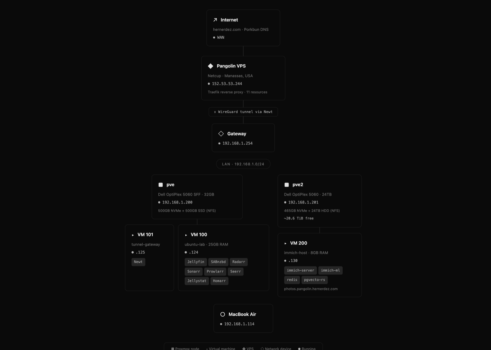

# hernerdez.com

Portfolio of Roberto Hernandez, Network Engineer & Software Developer in Houston, TX.
Live at **[hernerdez.com](https://hernerdez.com)**. Next.js 14 on Vercel.



## What's on the site

- **Home** – hero with a cycling typewriter, an About section built around a working terminal, and live cards that pull from Spotify and GitHub, a status pill, a Houston clock that reads my calendar, and a "ping me" button that actually measures the round trip.
- **[/homelab](https://hernerdez.com/homelab)** – interactive topology of my 3-node Proxmox cluster. Nodes go green or red from a status service running on the cluster itself, with 30-day uptime and time since the last outage.
- **[/ccna](https://hernerdez.com/ccna)** – how I passed the CCNA 200-301 (Nov 2026): resources, honest takes, exam tips, and the spaced-repetition app I built to drill my misses.
- **[/projects](https://hernerdez.com/projects)** – everything I've shipped.

## The interesting parts

**Live widgets without leaking anything.** Every third-party call goes through a route handler in `app/api/`, so tokens never reach the browser. Responses carry `Cache-Control` + `CDN-Cache-Control` so Vercel's edge serves repeats, and each handler returns a `503` when its environment variables are missing, at which point the matching card simply hides. The site works with zero secrets configured.

**Homelab status, end to end.** `services/homelab-status/` is a small FastAPI service that runs as a container on the cluster, probes each service every minute, keeps 35 days of samples in SQLite, and exposes a bearer-protected `/status` through a Pangolin tunnel. `/api/homelab` proxies it with a 30-second cache and serves the last good payload for 10 minutes if the lab is unreachable. The topology falls back to its static colours when there's no data at all.

**A calendar as the source of truth.** The Houston clock line ("It's 7:42 PM in Houston. I'm probably out running.") reads the iCal feed of a dedicated calendar. `lib/ics.ts` is a minimal parser that handles timed and all-day events, TZID/UTC, DURATION, daily/weekly RRULE with BYDAY/INTERVAL/UNTIL/COUNT, EXDATE, and events that cross midnight. A one-off event beats a repeating one, so dropping "at the Rockets game" over the routine just works.

**Terminal-style About.** The bio is a zsh prompt: `whoami`, `cat about.txt`, `ls skills/`, `uptime` play on scroll, then it takes commands (`help`, `contact`, `ccna`, `ping`, `sudo`, `clear`). Completed lines live in an `aria-live` log; the in-progress typing is hidden from screen readers so every keystroke isn't announced.

**CCNA Drill** is a separate repo: [Hernerdez/CCNA_Study](https://github.com/Hernerdez/CCNA_Study). No exam content is published anywhere; the demo deck is original questions.

## Stack

Next.js 14 (app router, route handlers), React 18, TypeScript, Tailwind CSS + shadcn/ui, framer-motion, date-fns. Deployed on Vercel from `main`. The homelab status service is Python 3.12 + FastAPI + SQLite in Docker.

```
app/            pages (/, /homelab, /ccna, /projects) and app/api/* route handlers
components/     UI; components/live/ are the About widgets, components/homelab/ the topology
lib/            data and pure helpers (ics parser, polyline decoder, api cache, page content)
hooks/          useLiveData polling hook, useIsMobile
services/       homelab-status (FastAPI) – runs on the cluster, not on Vercel
docs/           setup guides
```

## Running locally

```bash
npm install
cp .env.example .env.local   # optional: fill in what you have
npm run dev
```

Every widget is independent and hides itself when its variables are unset, so a bare `npm run dev` gives you the full site minus the live cards. Token walkthroughs (Spotify, GitHub, the calendar feed, the homelab service) are in [docs/live-widgets.md](docs/live-widgets.md).

## What this repo never contains

Secrets, the real hosts behind the homelab checks (`services/homelab-status/checks.yaml` is a template), camera details, and any certification exam content. If you spot something that shouldn't be here, open an issue.

## License

[MIT](LICENSE). Reuse the widgets; the words and pictures about me are mine.
